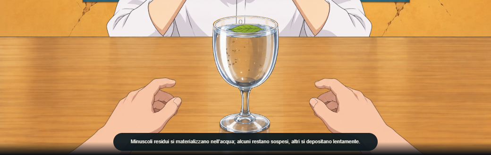
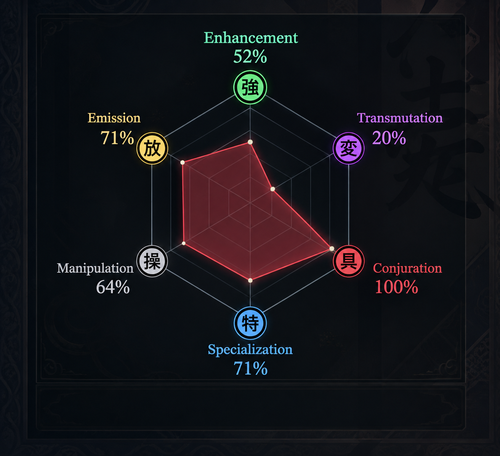
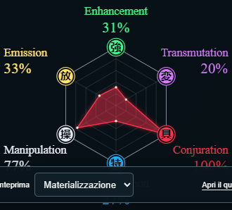

# Nen Divination — V4 Final Report

**Data:** 30 ottobre 2026. **Branch:** `final-polish-v4`. **Base approvata:** `8ea2133` su `main`.

La V4 è implementata nel repository esistente, senza riscrivere l’app. Sono conservati scena, mani, calice, quiz bilingue, scoring, sette domande più fino a due bonus, concentrazione di 4,5 secondi e GitHub Pages. Non sono stati eseguiti push, merge o deploy.

**Restano due limiti di rilascio:** i diritti sui ritratti non sono verificati; le prove iOS/Android sono emulazioni, senza una verifica su dispositivi fisici o nell’editor Instagram. La Story omette esplicitamente i ritratti senza permesso e presenta i tre personaggi con nomi e testi reali. La disponibilità tecnica dei 30 ritratti è stata verificata separatamente.

## Esito dei 15 punti originali

| # | Requisito | Risultato |
|---|---|---|
| 1 | Radar | SVG dinamico, sei medaglioni kanji, colori canonici e ordine fisso dall’alto: Enhancement, Transmutation, Conjuration, Specialization, Manipulation, Emission. Valori reali, riempimento del tipo principale. Controlli a 320/375/390/430/768/1280/1440 px, IT/EN, senza collisioni o tagli. |
| 2 | Personaggi | Pool esatta di 30, cinque per Nen; tre card iniziali e due espandibili, ordine stabile, transizione breve, `aria-expanded`, `aria-controls`, `inert`, focus conservato e riduzione del movimento. Descrizioni IT approvate riportate letteralmente, traduzioni EN statiche. Ritratti autentici identificati e verificati; permessi non dedotti dall’API. |
| 3 | Descrizioni poteri | Riviste le sei spiegazioni tecniche complete già presenti e conservate; migliorata l’affinità secondaria della Manipolazione. Capacità Nen distinte dai tratti del quiz; nessun potere universale inventato per gli Specialisti. |
| 4 | 24 domande e 96 risposte | Letti entrambi gli idiomi e confermati i testi già conformi. q07 usa il maestro Nen, Heavens Arena resta anche in IT, q19 conserva le quattro missioni approvate. Nessuna modifica a dataset, ID, vettori, calibrazione, tie-break o selezione bonus. |
| 5 | Dialoghi Wing | Battute brevi solo in intermezzi separati, automatici dopo circa 3 s, senza Continua/skip. Reazione garantita dopo la quarta risposta, con varietà senza ripetizioni immediate. Bonus, passaggio alla concentrazione e rivelazione attendono Continua. Cambio lingua senza riavviare il timer breve. |
| 6 | Gomiti | Layer SVG locale con la stessa posa decodificata: bordo delle maniche arrotondato e contatto/ombra sul tavolo. Non cambiano volto o postura generale. Il layer è escluso dal risultato per conservarne la scena superiore. |
| 7 | Tieni premuto | Posizione inferiore conservata dopo test touch/mouse/tastiera. Durata 4500 ms, progresso, rilascio, pointercancel, blur, scheda nascosta e alternativa accessibile verificati. |
| 8 | Repository | [Audit preventivo](V4_CLEANUP_AUDIT.md), README riscritto e coerente. Nessuna eliminazione di file. Escluse soltanto dal bundle pubblico le copie non autorizzate dei ritratti e una base acqua non usata dal runtime; sorgenti conservati. |
| 9 | Instagram | PNG 1080×1350 conservato; nuovo template Story 1080×1920, radar leggibile, descrizione breve e tre personaggi, area per sticker Link. Copia URL con fallback selezionabile. Web Share/file, annullamento e fallback download verificati; nessuna promessa di pubblicazione diretta o link cliccabile nel PNG. Ritratti non autorizzati omessi dall’export. |
| 10 | Sei effetti | Frame 0/50/100% desktop/mobile e video reali. Play, pausa, seek avanti/indietro, replay, stato finale, resize, scrolling e DPR 1/2/3 verificati. Golden Specializzazione preservata fuori dalla riparazione comune del vetro. |
| 11 | Potenziamento | Rimossa la superficie originale congelata dalla zona ridisegnata; superficie originale senza foglia rimappata verso il labbro con fronte realmente crescente. Colature e gocce più opache, della tinta del liquido. Nessun secondo calice o fascia di sfondo sopra il bordo. |
| 12 | Neferpitou | Nessuna citazione nelle battute o nelle descrizioni della rivelazione; personaggio conservato nel catalogo con il testo approvato. |
| 13 | Tooltip radar | Rimossi icona, asterisco e spiegazione espandibile sotto il radar. Nome accessibile e valori rimangono nel titolo SVG. |
| 14 | Mobile | Vignetta sollevata verso il busto di Wing, sopra il calice; triangolo rivolto al personaggio. Risposte bianche A–D conservate e scorrevoli, testi lunghi accessibili da tastiera, safe area e landscape verificati. |
| 15 | Commenti acqua | Frasi IT/EN brevi; Trasmutazione sincronizzata al gusto dolce al 90%, aspetto limpido. Rivelazione separata dal quiz; spiegazioni posizionate sopra il calice o nella fascia inferiore già esistente del risultato. |

## Scena superiore: conservazione verificata

Nessun asset approvato di Wing, mani, tappeto, tavolo o calice è stato sostituito. Il markup/scena/canvas persistono tra le fasi; la correzione dei gomiti non appare nella scena risultato. Solo il renderer acqua del Potenziamento riceve le correzioni richieste.

Il confronto desktop del risultato Materializzazione dà PNG **identico byte per byte** alla baseline. Nel confronto mobile 390×844, le immagini della scena misurano entrambe 390×242: differiscono 10 pixel nella piccola zona del bordo del calice (x166–182, y88–102), senza cambiamenti a mani, camera o stato finale. Non viene attribuita una causa certa alla differenza residua. I test controllano anche persistenza dei nodi, canvas e stato durante il cambio lingua.

| Baseline approvata | V4 |
|---|---|
|  |  |

## Screenshot e confronto con i riferimenti

Aprire [la galleria di confronto](docs/v4/visual-comparison.html): riferimenti approvati e screenshot reali affiancati, con ingrandimento. Contiene radar, scheda finale, scena superiore, mobile prima/dopo, intermezzo, bonus, concentrazione, Potenziamento e Story. I mockup non sono usati come immagini piatte dell’interfaccia.

| Radar approvato | Radar SVG V4 reale |
|---|---|
|  |  |

Due Nen diversi, con gli stessi vertici del radar:

- [Materializzazione desktop](docs/v4/screenshots/desktop-conjuration-result.png).
- [Specializzazione desktop](docs/v4/screenshots/desktop-specialization-result.png).
- [Risultato mobile](docs/v4/screenshots/mobile-conjuration-result.png).
- [Quiz mobile prima](docs/v4/screenshots/mobile-quiz-before.png) e [dopo](docs/v4/screenshots/mobile-quiz-after.png).
- [Intermezzo Wing](docs/v4/screenshots/desktop-interlude.png), [bonus 8](docs/v4/screenshots/desktop-bonus8.png), [bonus 9](docs/v4/screenshots/desktop-bonus9.png), [concentrazione](docs/v4/screenshots/desktop-concentration.png), [personaggi espansi](docs/v4/screenshots/characters-expanded.png).
- Versioni mobile: [intermezzo](docs/v4/screenshots/mobile-interlude.png), [bonus 8](docs/v4/screenshots/mobile-bonus8.png), [bonus 9](docs/v4/screenshots/mobile-bonus9.png), [concentrazione](docs/v4/screenshots/mobile-concentration.png).
- [Area di lettura della concentrazione a 320×568](docs/v4/screenshots/small-mobile-focus.png), corretta dopo la suite estesa. Sui display molto bassi le spiegazioni importanti si dispongono sotto le mani, con Continua raggiungibile, mentre domanda e reazioni brevi restano vicine a Wing.
- Potenziamento: [inizio](docs/v4/screenshots/desktop-enhancement-0.png), [intermedio](docs/v4/screenshots/desktop-enhancement-50.png), [finale](docs/v4/screenshots/desktop-enhancement-100.png), [mobile](docs/v4/screenshots/mobile-enhancement-50.png).
- [PNG Story 1080×1920 effettivamente esportato](docs/v4/screenshots/instagram-story.png).

Tutti i frame delle sei reazioni e i due video reali (desktop e mobile, sei sequenze ciascuno) sono in `.verification/v4/final/`; `frames.json` registra effetto, tempo e stato, `videos.json` identifica i due video completi dell’ultima acquisizione. Baseline animazioni in `.verification/v4/baseline-effects/`. I video grezzi rimangono fuori da Git e dal bundle. L’identità dei 30 ritratti è stata anche controllata visivamente nel contact sheet locale `.verification/v4/portrait-contact-sheet.png`.

## Catalogo dei 30 personaggi e immagini

Fonte identità: [Tenrai, cast di Hunter × Hunter 11061](https://api.tenrai.org/v1/anime/11061/characters), 205 record, associazioni esatte tramite nome/alias e ID MAL. I primi 18 ID/URL sono conservati. Il mapping Nen è editoriale, quello approvato nella [specifica V4 §2](NEN_DIVINATION_V4_CODEX/NEN_DIVINATION_FINAL_POLISH_V4.md); non è importato dall’API. Kurapika resta Materializzatore e la descrizione distingue l’accesso alla Specializzazione con occhi scarlatti.

**Stato comune a tutte le righe:** HTTP 200, risposta JPEG, decodifica browser e canvas CORS riusciti il 30 ottobre 2026; identità visiva verificata. **Permessi di redistribuzione non verificati per tutte e 30 le immagini.** I [termini Tenrai §§3 e 6](https://tenrai.org/terms) consentono l’uso del servizio e il caching dei metadati, senza concedere una licenza sulle illustrazioni di terzi. Nessun ritratto AI, nessuna nuova copia dei 12 ritratti aggiunti negli asset pubblici.

| Personaggio | Tipo Nen | ID MAL / fonte | URL ritratto | Verifica |
|---|---|---|---|---|
| Gon Freecss | Potenziamento | [30](https://myanimelist.net/character/30/Gon_Freecss) | [JPEG](https://cdn.myanimelist.net/images/characters/11/174517.jpg) | 200 / CORS OK |
| Isaac Netero | Potenziamento | [14489](https://myanimelist.net/character/14489/Isaac_Netero) | [JPEG](https://cdn.myanimelist.net/images/characters/7/257355.jpg) | 200 / CORS OK |
| Uvogin | Potenziamento | [5836](https://myanimelist.net/character/5836/Uvogin) | [JPEG](https://cdn.myanimelist.net/images/characters/14/198581.jpg) | 200 / CORS OK |
| Phinks Magcub | Potenziamento | [5834](https://myanimelist.net/character/5834/Phinks_Magkav) | [JPEG](https://cdn.myanimelist.net/images/characters/4/193009.jpg) | 200 / CORS OK |
| Palm Siberia | Potenziamento | [34054](https://myanimelist.net/character/34054/Palm_Siberia) | [JPEG](https://cdn.myanimelist.net/images/characters/10/211775.jpg) | 200 / CORS OK |
| Meruem | Emissione | [23277](https://myanimelist.net/character/23277/Meruem) | [JPEG](https://cdn.myanimelist.net/images/characters/6/243861.jpg) | 200 / CORS OK |
| Zeno Zoldyck | Emissione | [59](https://myanimelist.net/character/59/Zeno_Zoldyck) | [JPEG](https://cdn.myanimelist.net/images/characters/5/193007.jpg) | 200 / CORS OK |
| Razor | Emissione | [22518](https://myanimelist.net/character/22518/Razor) | [JPEG](https://cdn.myanimelist.net/images/characters/9/172385.jpg) | 200 / CORS OK |
| Leorio Paradinight | Emissione | [29](https://myanimelist.net/character/29/Leorio_Paladiknight) | [JPEG](https://cdn.myanimelist.net/images/characters/11/549311.jpg) | 200 / CORS OK |
| Knov | Emissione | [82925](https://myanimelist.net/character/82925/Knov) | [JPEG](https://cdn.myanimelist.net/images/characters/6/215471.jpg) | 200 / CORS OK |
| Killua Zoldyck | Trasmutazione | [27](https://myanimelist.net/character/27/Killua_Zoldyck) | [JPEG](https://cdn.myanimelist.net/images/characters/2/327920.jpg) | 200 / CORS OK |
| Hisoka Morow | Trasmutazione | [31](https://myanimelist.net/character/31/Hisoka_Morow) | [JPEG](https://cdn.myanimelist.net/images/characters/3/174561.jpg) | 200 / CORS OK |
| Biscuit Krueger | Trasmutazione | [13898](https://myanimelist.net/character/13898/Biscuit_Krueger) | [JPEG](https://cdn.myanimelist.net/images/characters/5/194667.jpg) | 200 / CORS OK |
| Machi Komacine | Trasmutazione | [5830](https://myanimelist.net/character/5830/Machi_Komachine) | [JPEG](https://cdn.myanimelist.net/images/characters/4/182389.jpg) | 200 / CORS OK |
| Feitan Portor | Trasmutazione | [3195](https://myanimelist.net/character/3195/Feitan_Portor) | [JPEG](https://cdn.myanimelist.net/images/characters/10/174721.jpg) | 200 / CORS OK |
| Kurapika | Materializzazione | [28](https://myanimelist.net/character/28/Kurapika) | [JPEG](https://cdn.myanimelist.net/images/characters/3/549312.jpg) | 200 / CORS OK |
| Kite | Materializzazione | [20594](https://myanimelist.net/character/20594/Kite) | [JPEG](https://cdn.myanimelist.net/images/characters/5/203429.jpg) | 200 / CORS OK |
| Shizuku Murasaki | Materializzazione | [5833](https://myanimelist.net/character/5833/Shizuku_Murasaki) | [JPEG](https://cdn.myanimelist.net/images/characters/10/178469.jpg) | 200 / CORS OK |
| Knuckle Bine | Materializzazione | [29809](https://myanimelist.net/character/29809/Knuckle_Bine) | [JPEG](https://cdn.myanimelist.net/images/characters/6/572043.jpg) | 200 / CORS OK |
| Genthru | Materializzazione | [33300](https://myanimelist.net/character/33300/Genthru) | [JPEG](https://cdn.myanimelist.net/images/characters/9/552880.jpg) | 200 / CORS OK |
| Illumi Zoldyck | Manipolazione | [57](https://myanimelist.net/character/57/Illumi_Zoldyck) | [JPEG](https://cdn.myanimelist.net/images/characters/8/174521.jpg) | 200 / CORS OK |
| Morel Mackernasey | Manipolazione | [29806](https://myanimelist.net/character/29806/Morel_Mackernasey) | [JPEG](https://cdn.myanimelist.net/images/characters/13/211097.jpg) | 200 / CORS OK |
| Shalnark | Manipolazione | [5832](https://myanimelist.net/character/5832/Shalnark_Ryuseih) | [JPEG](https://cdn.myanimelist.net/images/characters/7/178463.jpg) | 200 / CORS OK |
| Kalluto Zoldyck | Manipolazione | [6089](https://myanimelist.net/character/6089/Kalluto_Zoldyck) | [JPEG](https://cdn.myanimelist.net/images/characters/2/246235.jpg) | 200 / CORS OK |
| Shaiapouf | Manipolazione | [41135](https://myanimelist.net/character/41135/Shaiapouf) | [JPEG](https://cdn.myanimelist.net/images/characters/3/563303.jpg) | 200 / CORS OK |
| Chrollo Lucilfer | Specializzazione | [58](https://myanimelist.net/character/58/Chrollo_Lucilfer) | [JPEG](https://cdn.myanimelist.net/images/characters/4/182387.jpg) | 200 / CORS OK |
| Neferpitou | Specializzazione | [12300](https://myanimelist.net/character/12300/Neferpitou) | [JPEG](https://cdn.myanimelist.net/images/characters/12/253673.jpg) | 200 / CORS OK |
| Pakunoda | Specializzazione | [5835](https://myanimelist.net/character/5835/Pakunoda) | [JPEG](https://cdn.myanimelist.net/images/characters/2/533870.jpg) | 200 / CORS OK |
| Neon Nostrade | Specializzazione | [17564](https://myanimelist.net/character/17564/Neon_Nostrade) | [JPEG](https://cdn.myanimelist.net/images/characters/16/185665.jpg) | 200 / CORS OK |
| Meleoron | Specializzazione | [29808](https://myanimelist.net/character/29808/Meleoron) | [JPEG](https://cdn.myanimelist.net/images/characters/8/205215.jpg) | 200 / CORS OK |

Le copie dei 18 ritratti già presenti sono usate soltanto per la prova locale; il bundle pubblico le esclude se prive di autorizzazione. Le schede possono referenziare la fonte remota, con nome/tecnica e fallback esplicito se l’immagine manca. Questo non risolve il permesso di pubblicazione: prima del rilascio ottenere l’autorizzazione dai titolari, fornire immagini autentiche con licenza o pubblicare schede testuali con link alle fonti. Anche la condivisione pubblica dei riferimenti e degli screenshot va valutata rispetto ai relativi diritti.

La Story omette i ritratti senza permesso; per quelli autorizzati il percorso di caricamento verifica CORS, tipo risposta, timeout e dimensioni. Un errore mantiene il PNG utilizzabile con tre schede testuali, senza simulare immagini presenti.

## Test eseguiti

La copertura conclusiva comprende **169 casi E2E distinti superati e 21 esclusioni previste** su cinque progetti (190 casi disponibili). Il totale aggrega la suite estesa e le ripetizioni mirate dopo la correzione; non rappresenta un’unica esecuzione tutta verde. Nessun difetto riproducibile rimane aperto.

| Comando / verifica | Esito | Evidenza locale |
|---|---|---|
| `npm.cmd test` | **28/28**, sei file Vitest | Verifica finale dopo le correzioni D. |
| `npm.cmd run test:simulation` | **30.000 partite + 6.000 profili**, superata | Stessi esiti della base: vincite casuali 15,56–17,557%; 7/8/9 domande: 19.218 / 7.013 / 3.769. |
| `npm.cmd run build` | **Superata** | `.verification/v4/final-build.log`. |
| `npm.cmd run test:build` | **Superata**, desktop/mobile sotto `/nen-divination/`, rete consentita | Quiz completo, persistenza effetto, download PNG, asset e riferimenti esclusi. |
| `npm.cmd run build:review` + `node scripts/verify-build.mjs --review` | **Superati**, rete consentita | `.verification/v4/review-build.log`; cache locale conservata. |
| `npm.cmd run test:e2e` | 185 casi: **163 superati, 21 esclusi, 1 difetto 320×568 poi corretto** | `.verification/v4/full-e2e.log`. |
| `npx.cmd playwright test e2e/divination.spec.js e2e/v4-dialogue.spec.js e2e/v4-mobile-share.spec.js e2e/v4-export.spec.js --project=desktop --project=small-mobile --project=mobile-webkit` | Verifiche dopo la correzione: 15 superate, 2 escluse; un tentativo desktop interessato da una navigazione durante la prova, poi ripetuto isolatamente con successo | `.verification/v4/final-checks.log`, `.verification/v4/desktop-recheck.log`; metadati dell’ultima ripetizione: `status: passed`, nessun test fallito. |
| `npx.cmd playwright test e2e/divination.spec.js --project=desktop --grep 'progressive hold'` | **1/1**, ripetizione isolata riuscita | `.verification/v4/desktop-recheck/`. |
| `npx.cmd playwright test e2e/v4-export.spec.js --project=tablet --project=mobile` | **2/2** | `.verification/v4/export-recheck.log` e metadati `status: passed`. |
| `npx.cmd playwright test e2e/v4-dialogue.spec.js e2e/v4-qa.spec.js --project=small-mobile` | **3 superati, 1 escluso duplicato**, ultima verifica della lettura a 320×568 e dei bonus 8/9 | `.verification/v4/small-reading-recheck/`. |
| `node scripts/audit-character-images.mjs` | **30/30**, HTTP/JPEG/browser/CORS | `.verification/v4/portrait-audit.json` e catalogo tracciato. |
| `node scripts/review-v4.mjs --phase=final` | **36 frame temporali, 12 risultati, due video completi** | `.verification/v4/final/frames.json`, `videos.json`; screenshot puliti dopo aver nascosto i controlli di review. |

Le 21 esclusioni sono duplicati intenzionali fuori dal desktop (test offline esteso, fallback asset, griglia a sette larghezze, emulazioni esplicite e DPR) e il confronto PNG specifico di Chromium su WebKit. Le funzionalità corrispondenti sono esercitate nei progetti dedicati.

Baseline prima degli interventi: 25 unitari e build superati; tutti i 30 E2E desktop superati, poi la baseline estesa è stata interrotta deliberatamente per iniziare gli interventi. Non viene conteggiata come suite iniziale completa.

Verifiche incrementali: A, due E2E dialoghi desktop/mobile; B, radar in due lingue e due risultati su sette larghezze; C, 21 test animazioni superati con un’esclusione specifica del golden Chromium, tre test mobile/Story e due test hold touch. Gli esiti conclusivi della tabella sopra includono le verifiche aggiornate all’intero flusso V4.

Anche la build `local-review` e la relativa percorrenza sotto `/nen-divination/` sono state verificate con rete consentita. I due video completi sono stati decodificati nel browser: 65,52 secondi desktop e 56,88 secondi mobile.

La prima verifica della build pubblica aveva fallito per `ERR_NETWORK_ACCESS_DENIED` del sandbox sui CDN. Ripetuta con rete consentita, è passata con tutte le richieste asset. La prima serie C aveva rilevato una vecchia aspettativa che richiedeva il nome Neferpitou e una vignetta troppo bassa di pochi pixel: l’aspettativa è stata aggiornata al mandato e il layout corretto. La suite estesa D ha individuato una copertura dell’acqua nella review di concentrazione a **320×568**: corretta con un’area di lettura interna scorrevole, senza tagliare il triangolo della vignetta, e ripetuti il caso e i controlli correlati su Chromium/WebKit. Il confronto screenshot ha anche rilevato e fatto rimuovere una fascia di sfondo nell’animazione e uno sfondo PNG trasparente non voluto. Nessuno di questi errori viene presentato come esito positivo.

Prestazioni: con CPU emulata 4× più lenta, 24 campioni per effetto e DPR 1/2/3, il p95 del solo disegno del compositore è **0,6–3,3 ms**. Misura locale, senza promessa di FPS su dispositivi fisici e senza includere tutta la pipeline del browser. Dati in `.verification/v4/performance.json`.

Bundle verificato: **20 file, 15.000.771 byte**; JavaScript **153,19 kB / 45,33 kB gzip**, CSS **56,32 kB / 12,15 kB gzip** nella build verificata. La maggior parte del peso resta negli asset anime approvati e negli atlas. La pulizia evita la pubblicazione della base acqua inutilizzata e delle copie locali dei ritratti non autorizzati, circa 2,33 MB. Entry di review, riferimenti e sorgenti privati non entrano in `dist`.

## Commit e file

| Fase | Commit locale | Contenuto |
|---|---|---|
| A | `50886b8` | Contenuti approvati, catalogo 30, dialoghi separati, gomiti, test editoriali. |
| B | `a1c089e` | Radar canonico, kanji, card 3+2, audit dei ritratti, QA responsive. |
| C | `a30639c` | Acqua del Potenziamento, mobile, Story e link, verifiche browser. |
| D | `HEAD` — `Polish V4 phase D: QA, production audit and final comparison report` | Suite conclusiva, audit, README, screenshot e questo rapporto. L’hash effettivo si legge con `git log -1 --oneline`. |

<details>
<summary>Elenco completo dei 76 file aggiunti o modificati rispetto alla base</summary>

- [.gitignore](.gitignore)
- [NEN_DIVINATION_V4_CODEX/CHECKLIST_RIFINITURE_V4.md](NEN_DIVINATION_V4_CODEX/CHECKLIST_RIFINITURE_V4.md)
- [NEN_DIVINATION_V4_CODEX/LEGGIMI_V4.md](NEN_DIVINATION_V4_CODEX/LEGGIMI_V4.md)
- [NEN_DIVINATION_V4_CODEX/NEN_DIVINATION_FINAL_POLISH_V4.md](NEN_DIVINATION_V4_CODEX/NEN_DIVINATION_FINAL_POLISH_V4.md)
- [NEN_DIVINATION_V4_CODEX/references/BONUS_COMMENTO_DA_SEPARARE.png](NEN_DIVINATION_V4_CODEX/references/BONUS_COMMENTO_DA_SEPARARE.png)
- [NEN_DIVINATION_V4_CODEX/references/ESAGONO_CANONICO_COLORI_POSIZIONI.png](NEN_DIVINATION_V4_CODEX/references/ESAGONO_CANONICO_COLORI_POSIZIONI.png)
- [NEN_DIVINATION_V4_CODEX/references/INTERMEZZO_WING_STILE_APPROVATO.png](NEN_DIVINATION_V4_CODEX/references/INTERMEZZO_WING_STILE_APPROVATO.png)
- [NEN_DIVINATION_V4_CODEX/references/MOBILE_QUIZ_ATTUALE_DA_RIFINIRE.png](NEN_DIVINATION_V4_CODEX/references/MOBILE_QUIZ_ATTUALE_DA_RIFINIRE.png)
- [NEN_DIVINATION_V4_CODEX/references/RADAR_ATTUALE_PROBLEMA_LABEL.png](NEN_DIVINATION_V4_CODEX/references/RADAR_ATTUALE_PROBLEMA_LABEL.png)
- [NEN_DIVINATION_V4_CODEX/references/RADAR_V4_APPROVATO.png](NEN_DIVINATION_V4_CODEX/references/RADAR_V4_APPROVATO.png)
- [NEN_DIVINATION_V4_CODEX/references/SCHEDA_RISULTATO_LAYOUT_APPROVATO.png](NEN_DIVINATION_V4_CODEX/references/SCHEDA_RISULTATO_LAYOUT_APPROVATO.png)
- [README.md](README.md)
- [V4_CLEANUP_AUDIT.md](V4_CLEANUP_AUDIT.md)
- [V4_FINAL_REPORT.md](V4_FINAL_REPORT.md)
- [V4_WORK_LOG.md](V4_WORK_LOG.md)
- [docs/v4/screenshots/characters-expanded.png](docs/v4/screenshots/characters-expanded.png)
- [docs/v4/screenshots/desktop-bonus8.png](docs/v4/screenshots/desktop-bonus8.png)
- [docs/v4/screenshots/desktop-bonus9.png](docs/v4/screenshots/desktop-bonus9.png)
- [docs/v4/screenshots/desktop-concentration.png](docs/v4/screenshots/desktop-concentration.png)
- [docs/v4/screenshots/desktop-conjuration-result.png](docs/v4/screenshots/desktop-conjuration-result.png)
- [docs/v4/screenshots/desktop-enhancement-0.png](docs/v4/screenshots/desktop-enhancement-0.png)
- [docs/v4/screenshots/desktop-enhancement-100.png](docs/v4/screenshots/desktop-enhancement-100.png)
- [docs/v4/screenshots/desktop-enhancement-50.png](docs/v4/screenshots/desktop-enhancement-50.png)
- [docs/v4/screenshots/desktop-interlude.png](docs/v4/screenshots/desktop-interlude.png)
- [docs/v4/screenshots/desktop-specialization-result.png](docs/v4/screenshots/desktop-specialization-result.png)
- [docs/v4/screenshots/instagram-story.png](docs/v4/screenshots/instagram-story.png)
- [docs/v4/screenshots/mobile-bonus8.png](docs/v4/screenshots/mobile-bonus8.png)
- [docs/v4/screenshots/mobile-bonus9.png](docs/v4/screenshots/mobile-bonus9.png)
- [docs/v4/screenshots/mobile-concentration.png](docs/v4/screenshots/mobile-concentration.png)
- [docs/v4/screenshots/mobile-conjuration-result.png](docs/v4/screenshots/mobile-conjuration-result.png)
- [docs/v4/screenshots/mobile-enhancement-50.png](docs/v4/screenshots/mobile-enhancement-50.png)
- [docs/v4/screenshots/mobile-interlude.png](docs/v4/screenshots/mobile-interlude.png)
- [docs/v4/screenshots/mobile-quiz-after.png](docs/v4/screenshots/mobile-quiz-after.png)
- [docs/v4/screenshots/mobile-quiz-before.png](docs/v4/screenshots/mobile-quiz-before.png)
- [docs/v4/screenshots/radar-v4.png](docs/v4/screenshots/radar-v4.png)
- [docs/v4/screenshots/small-mobile-focus.png](docs/v4/screenshots/small-mobile-focus.png)
- [docs/v4/screenshots/upper-scene-after.png](docs/v4/screenshots/upper-scene-after.png)
- [docs/v4/screenshots/upper-scene-before.png](docs/v4/screenshots/upper-scene-before.png)
- [docs/v4/visual-comparison.html](docs/v4/visual-comparison.html)
- [e2e/app.spec.js](e2e/app.spec.js)
- [e2e/divination-effects.spec.js](e2e/divination-effects.spec.js)
- [e2e/helpers/dialogue.js](e2e/helpers/dialogue.js)
- [e2e/rendering.spec.js](e2e/rendering.spec.js)
- [e2e/result-layout.spec.js](e2e/result-layout.spec.js)
- [e2e/v2-scene.spec.js](e2e/v2-scene.spec.js)
- [e2e/v4-dialogue.spec.js](e2e/v4-dialogue.spec.js)
- [e2e/v4-export.spec.js](e2e/v4-export.spec.js)
- [e2e/v4-mobile-share.spec.js](e2e/v4-mobile-share.spec.js)
- [e2e/v4-qa.spec.js](e2e/v4-qa.spec.js)
- [e2e/v4-result.spec.js](e2e/v4-result.spec.js)
- [review/divination.js](review/divination.js)
- [review/results.js](review/results.js)
- [scripts/audit-character-images.mjs](scripts/audit-character-images.mjs)
- [scripts/import-v4-editorial.mjs](scripts/import-v4-editorial.mjs)
- [scripts/review-result-layout.mjs](scripts/review-result-layout.mjs)
- [scripts/review-v4.mjs](scripts/review-v4.mjs)
- [scripts/verify-build.mjs](scripts/verify-build.mjs)
- [src/components/CharacterCards.js](src/components/CharacterCards.js)
- [src/components/NenRadar.js](src/components/NenRadar.js)
- [src/components/QuizScene.js](src/components/QuizScene.js)
- [src/components/ResultView.js](src/components/ResultView.js)
- [src/components/WaterArtPass.js](src/components/WaterArtPass.js)
- [src/components/divinationTimeline.js](src/components/divinationTimeline.js)
- [src/data/characterImages.json](src/data/characterImages.json)
- [src/data/characters.js](src/data/characters.js)
- [src/data/nenTypes.js](src/data/nenTypes.js)
- [src/data/resultPresentation.js](src/data/resultPresentation.js)
- [src/data/translations.js](src/data/translations.js)
- [src/game/share.js](src/game/share.js)
- [src/main.js](src/main.js)
- [src/services/tenrai.js](src/services/tenrai.js)
- [src/styles/result.css](src/styles/result.css)
- [src/styles/unified-scene.css](src/styles/unified-scene.css)
- [src/tests/questions.test.js](src/tests/questions.test.js)
- [src/tests/v4-editorial.test.js](src/tests/v4-editorial.test.js)
- [vite.config.js](vite.config.js)

</details>

Il pacchetto V4 originariamente non tracciato è stato conservato e incluso nel checkpoint A, senza modificarne le istruzioni. Nessun reset distruttivo, nessuna cancellazione della cronologia. `main` resta a `8ea2133`.

## Avvio senza push e limiti residui

```powershell
git switch final-polish-v4
npm.cmd ci
npm.cmd run dev
```

Aprire `http://localhost:5173/`, oppure direttamente `/review/results.html` e `/review/divination.html`. Per la produzione locale: `npm.cmd run build`, `npm.cmd run preview`, quindi aprire l’URL con prefisso `/nen-divination/`. Per ripetere i confronti: `node scripts/review-v4.mjs --phase=final` con Vite attivo. Il [README](README.md) descrive i comandi completi, immagini esterne e futura pubblicazione da parte del proprietario.

Prima di pubblicare restano da verificare:

- **Permessi:** nessuna licenza verificata per i 30 ritratti o per le pose Wing preesistenti. Stato registrato, senza dichiarare autorizzazioni inesistenti. L’app rimane utilizzabile se le immagini remote non rispondono.
- **Dispositivi fisici:** provare iOS Safari, Android Chrome e l’effettivo inserimento dello sticker Link nell’editor Instagram. I test WebKit/Chromium emulati coprono download e condivisione/fallback, non un caricamento reale su Instagram.
- **Giudizio artistico finale:** il trabocco usa lo stesso sistema 2D e le sagome illustrate esistenti; il video e la review consentono al proprietario di valutarne il movimento. Non è una simulazione 3D o una nuova illustrazione del calice.

Il workflow Pages è pronto ed è conservato. Questa consegna non lo ha attivato e non ha pubblicato la V4.
